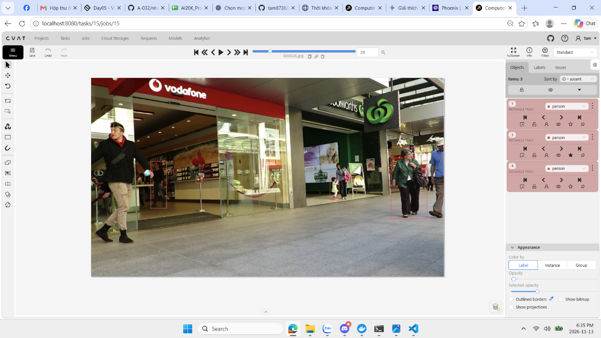
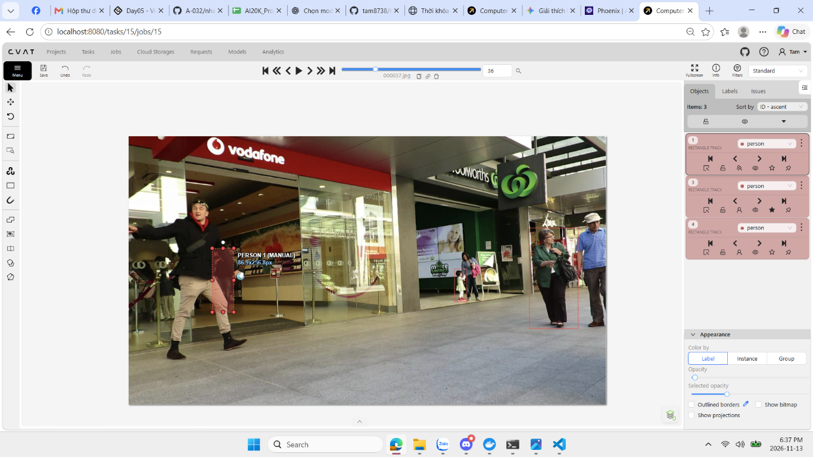
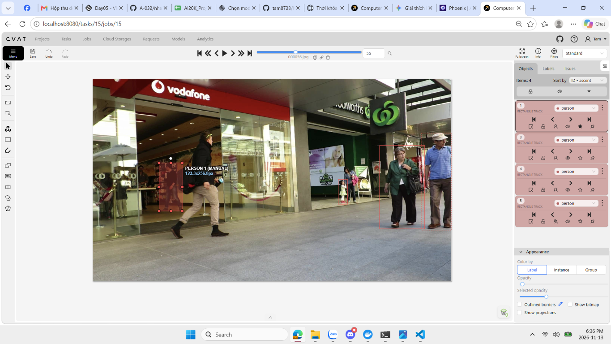

# Báo cáo cá nhân — Trương Mỹ Tâm (03106)

Đoạn video: MOT17-09, 150 frame (frame 1–150), nguồn MOTChallenge, giấy phép CC BY-NC-SA 3.0.

## 0. Thông tin học viên

- Họ tên: Trương Mỹ Tâm
- MSSV: 03106
- Mã đề (A/B/C): A
- Email:truongtam18072003@gmail.com
- Link repository:https://github.com/tam8738/K5-L2-DAY05-TruongMyTam-03106-MOTTracking.git
- Giờ bắt đầu:16h36
- Giờ kết thúc: 18h15

## 1. Xem trước đoạn video (CP0)

Ghi **trước khi vẽ**, mỗi người một dòng.

| Mã | Frame xuất hiện | Frame cuối thấy được | Rẽ / dừng / đổi tốc độ ở frame | Bị che ở frame | Ghi chú |
|---|---|---|---|---|---|
| P1 | 000000 | 000149 | - | 000030–000044 | File 000001.jpg là frame 0; file 000150.jpg là frame 149. |
| P2 | 000061 | 000149 | 000083 | 000060–000073 | Frame 83 tương ứng ảnh thứ tự 84. |
| P3 | 000000 | 000149 | - | 000039–000064 | |
| P4 | 000000 | 000146 | - | - | Frame 146 tương ứng ảnh thứ tự 147. |
| P5 | 000040 | 000149 | - | 000106–000148 | |

## 2. Keyframe và thời gian (CP1, CP4)

Số keyframe lấy từ kết quả `src/check_submission.py`.

| Mã | Số keyframe | Keyframe ở frame | Số frame có mặt | Keyframe / 100 frame | Thời gian (phút) | Chỗ khó |
|---|---|---|---|---|---|---|
| P1 | 28 | 0, 10, 20, 26, 27, 28, 29, 30, 40, 45, 50, 51, 53, 54, 55, 60, 70, 80, 90, 96, 100, 109, 110, 115, 118, 120, 130, 149 | 146 | 19,2 | Chưa ghi riêng | Nhiều keyframe gần đoạn che; outside 41–44 |
| P2 | 15 | 61, 71, 75, 81, 86, 87, 91, 92, 101, 111, 116, 121, 131, 141, 149 | 89 | 16,9 | Chưa ghi riêng | Rẽ ở frame 83; bị che theo ghi chú mục 1 |
| P3 | 20 | 0, 10, 20, 25, 30, 36, 38, 39, 40, 50, 60, 70, 80, 90, 100, 110, 120, 130, 140, 149 | 150 | 13,3 | Chưa ghi riêng | Bị che theo ghi chú mục 1 |
| P4 | 9 | 0, 10, 20, 30, 40, 106, 135, 140, 142 | 123 | 7,3 | Chưa ghi riêng | Outside 111–134; kết thúc ở frame 146 |
| P5 | 27 | 40, 42, 50, 60, 66, 68, 70, 80, 81, 82, 90, 100, 101, 102, 106, 107, 110, 112, 116, 120, 125, 126, 130, 136, 140, 146, 149 | 110 | 24,5 | Chưa ghi riêng | Bị che theo ghi chú mục 1 |
| **Tổng** | **99** | | **618** | **16,0** | | |

Keyframe / 100 frame của cả bài = 99 ÷ 618 × 100 = **16,0**.

Bạn đặt keyframe nhiều nhất ở người nào? Vì sao (người đó rẽ, dừng, lại gần camera hay bị che)?

 Tôi đặt keyframe ở người P1 và P4, mỗi người 1 keyframe vì họ bị che xong xuất hiện trở lại.

P1 có 28 keyframe, nhiều nhất trong các track. Các keyframe tập trung quanh giai đoạn 26–30 và trước/sau khoảng outside 41–44 để box theo sát người khi chuyển động và bị che.

## 3. Đoạn bị che (CP2)

Người bị che: `P1` (khoảng bạn cung cấp: 000031–000045)

| Mốc | Frame |
|---|---:|
| Bắt đầu bị che một phần (bật `occluded`) | 000031 |
| Mất hẳn (bật `outside`) | 000041 (theo khoảng outside 41–44 trong kết quả kiểm tra) |
| Hiện lại (tắt `outside`) | 000045 (suy ra từ khoảng outside 41–44) |
| Thấy rõ trở lại (tắt `occluded`) | 000055 (thấy rõ trong ảnh sau khi hiện lại) |

- Thời gian khuất hẳn: 4 frame (000041–000044) = khoảng 0,13 giây, theo khoảng outside trong kết quả kiểm tra.
- Quyết định: giữ cùng ID (P1 được gán trong một track xuyên suốt đoạn).
- Lý do (trả lời 3 câu: khuất bao lâu so với 60 frame, ngoại hình có khớp, chỗ hiện lại có đúng hướng và tốc độ):

Đoạn khuất hẳn 4 frame, ngắn hơn ngưỡng 60 frame. Tôi giữ cùng ID vì nhận ra đó vẫn là cùng một người. Hãy ghi nhận xét của bạn về hướng đi và tốc độ khi P1 xuất hiện lại.

Ảnh chụp màn hình:





Nguồn ảnh: MOT17, MOTChallenge (Milan et al., 2016).

## 4. Tự review ID (CP3)

Lượt 1 theo người (đi ngược từ frame 149 về 0 trên CVAT), lượt 2 theo cảnh (nhảy 10 frame). Ít nhất 3 dòng; không có lỗi thì ghi một dòng "đã kiểm hai lượt, không lỗi".

Loại lỗi dùng đúng một trong 7 mã: `id_switch`, `fragmentation`, `lost`, `merge`, `false_track`, `drift`, `flag`.

| Frame | Mã người | Loại lỗi | Mô tả một câu | Phát hiện ở lượt | Đã sửa? |
|---:|---|---|---|---|---|
|_|_|_|Đã kiểm 2 lượt, không lỗi|lượt 1,2|Không cần sửa|
| | | | | | |
| | | | | | |

Tổng hợp số lỗi theo loại:

| `id_switch` | `fragmentation` | `lost` | `merge` | `false_track` | `drift` | `flag` |
|---:|---:|---:|---:|---:|---:|---:|
| | | | | | | |

Lỗi nào chỉ lượt 2 (theo cảnh) mới thấy, lượt 1 (theo người) không thấy? Vì sao?

Không có lỗi
...

## 5. File xuất và kết quả tự kiểm (CP4)

| Kiểm tra | Kết quả |
|---|---|
| Tên file MOT 1.1 | `TruongMyTam_mot.zip` |
| Tên file CVAT for video 1.1 | `TruongMyTam_cvat_video.zip` |
| Số track ID khác nhau trong `gt/gt.txt` (phải là 5) | 5 |
| Frame `outside` không có dòng trong `gt/gt.txt` (đúng / sai) | Đúng; script nhận diện khoảng vắng P1: 41–44 và P4: 111–134. |
| Job đã completed trên CVAT máy cá nhân | Cần xác nhận |

Dán phần tóm tắt in ra từ `src/check_submission.py`:

```text
Số frame in theo CVAT (bắt đầu từ 0). Trong gt.txt, frame_id = frame CVAT + 1.

=== File MOT 1.1: TruongMyTam_mot.zip ===
  Số track ID: 5   |   Tổng số box: 618
  [OK]        Đúng 5 track ID.

  Track | Frame có mặt | Số frame | Đoạn vắng (outside)
      1 |   0–149      |      146 | 41–44
      2 |   0–149      |      150 | -
      3 |   0–146      |      123 | 111–134
      4 |  40–149      |      110 | -
      5 |  61–149      |       89 | -

=== File CVAT for video 1.1: TruongMyTam_cvat_video.zip ===
  Track | Nhãn   | Frame thấy | Keyframe | KF/100 frame | Frame occluded | Lần bật outside
      0 | person |        146 |       28 |         19.2 |             25 |               1
              Track 0: keyframe ở frame [0, 10, 20, 26, 27, 28, 29, 30, 40, 45, 50, 51, 53, 54, 55, 60, 70, 80, 90, 96, 100, 109, 110, 115, 118, 120, 130, 149]
      1 | person |         89 |       15 |         16.9 |             14 |               0
              Track 1: keyframe ở frame [61, 71, 75, 81, 86, 87, 91, 92, 101, 111, 116, 121, 131, 141, 149]
      2 | person |        150 |       20 |         13.3 |              0 |               0
              Track 2: keyframe ở frame [0, 10, 20, 25, 30, 36, 38, 39, 40, 50, 60, 70, 80, 90, 100, 110, 120, 130, 140, 149]
      3 | person |        123 |        9 |          7.3 |             17 |               2
              Track 3: keyframe ở frame [0, 10, 20, 30, 40, 106, 135, 140, 142]
      4 | person |        110 |       27 |         24.5 |             26 |               0
              Track 4: keyframe ở frame [40, 42, 50, 60, 66, 68, 70, 80, 81, 82, 90, 100, 101, 102, 106, 107, 110, 112, 116, 120, 125, 126, 130, 136, 140, 146, 149]

  Tổng: 99 keyframe / 618 frame có mặt = 16.0 keyframe / 100 frame
  [OK]        Đọc được 5 track từ annotations.xml.

=== Tóm tắt ===
  Lỗi: 0   |   Cảnh báo: 0
  Đạt.
```

## 6. Ba câu kết

1. Nếu được gán lại, bạn sẽ đặt keyframe khác ở đâu? Vì sao?

   Tôi không thêm hay thay đổi keyframe nào, vì các box vẫn bám theo người giữa các keyframe kể cả sau khi người đó bị che khuất và xuất hiện trở lại.

2. Có chỗ nào bạn không chắc "cùng ID hay ID mới"? Bạn đã quyết định và ghi chú thế nào?

   Ở P4, khoảng frame 000111 - 000138, tôi giữ ID cũ vì người đó đã xuất hiện lại sau 27frame. Theo quy tắc, tạo ID mới khi người đó khuất hơn 60 frame.

3. Một lỗi ID trong job của bạn (nếu không còn sót, chọn lỗi đã sửa) có thể làm xe tự lái dự đoán sai chuyển động của người đó như thế nào? Lỗi đó ảnh hưởng MOTA hay IDF1 nhiều hơn?

   Không có lỗi nào cả 

## Bonus (nếu làm)

### B1 — Hai người đi sát

...

### B2 — So cách đặt keyframe

| Cách đặt | Số keyframe | Frame trôi nhất | Ghi chú |
|---|---:|---:|---|
| Đều mỗi 30 frame | | | |
| Theo chỗ đổi hướng | | | |

...

### B3 — So với tracker có sẵn

| Frame | Mã người | Tracker làm gì | Nhãn của bạn | Giải thích (đoán rồi sửa / ghép IoU / box score thấp / ngoại hình) |
|---:|---|---|---|---|
| | | | | |
| | | | | |

## 7. Tài liệu tham khảo và công cụ AI đã dùng

- MOT17, MOTChallenge (Milan et al., 2016), giấy phép CC BY-NC-SA 3.0.
- ChatGPT (OpenAI): hỗ trợ giải thích hướng dẫn lab và quy tắc định dạng/frame, giải thích kết quả tự kiểm, rà soát câu chữ và tính nhất quán của báo cáo.
